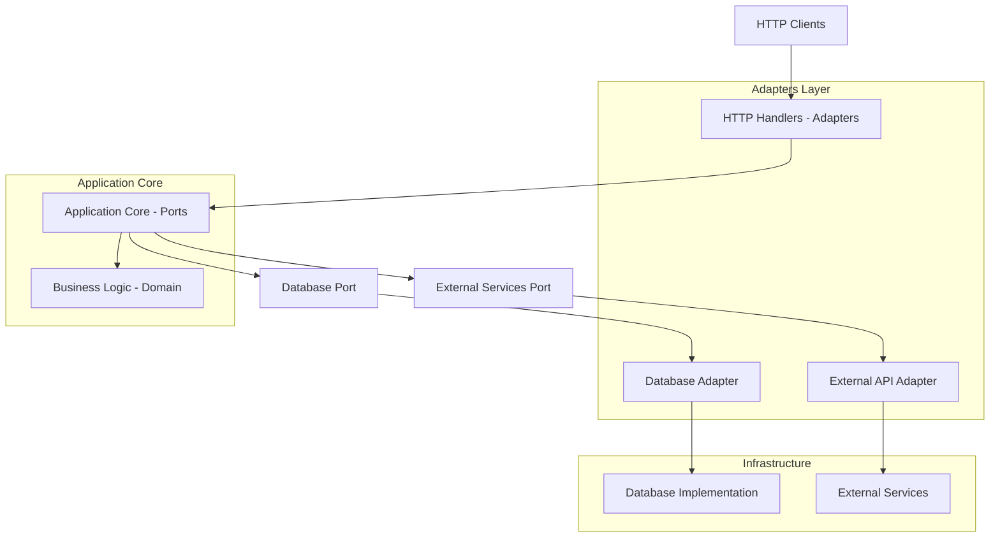
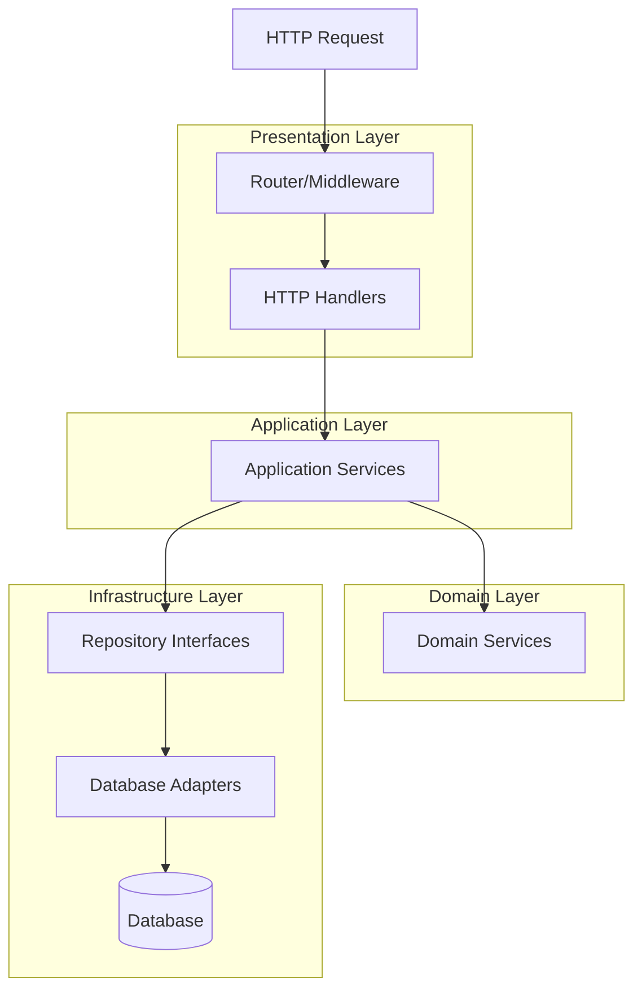
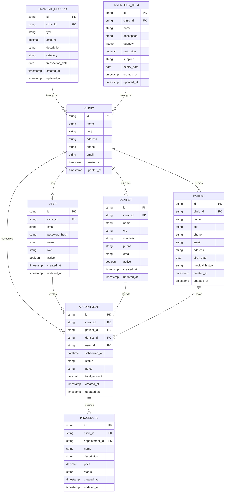

# Arquitetura Técnica - API Go para Clínicas Odontológicas

## 1.Architecture design



## 2.Technology Description

- Frontend: React@18 + tailwindcss@3 + vite
- Backend: Go@1.22 + gorilla/mux + AWS SDK v2
- Database: NoSQL Database (DynamoDB/MongoDB)
- Authentication: JWT
- Documentation: Swagger/OpenAPI
- Containerization: Docker + Docker Compose
- **Monitoramento**: Prometheus + Grafana
- **Cache**: Redis (opcional para sessões)

## 3.Route definitions

| Route | Purpose |
|-------|---------|
| /health | Health check endpoint |
| /api/v1/auth/login | User authentication |
| /api/v1/auth/register | User registration |
| /api/v1/dental/dentists | Dentist management |
| /api/v1/dental/patients | Patient management |
| /api/v1/dental/appointments | Appointment scheduling |
| /api/v1/dental/procedures | Procedure catalog |
| /api/v1/financial/invoices | Invoice management |
| /api/v1/financial/payments | Payment processing |
| /api/v1/admin/clinics | Clinic administration |
| /api/v1/admin/users | User management |

## 4.Definições da API

### 4.1 APIs Principais

**Autenticação de Usuários**
```
POST /api/v1/auth/login
```

Request:
| Nome do Parâmetro | Tipo | Obrigatório | Descrição |
|-------------------|------|-------------|-----------|
| email | string | true | Email do usuário |
| password | string | true | Senha do usuário |

Response:
| Nome do Parâmetro | Tipo | Descrição |
|-------------------|------|-----------|
| token | string | JWT token de acesso |
| refresh_token | string | Token para renovação |
| user | object | Dados do usuário autenticado |

Exemplo:
```json
{
  "email": "dentista@clinica.com",
  "password": "senha123"
}
```

**Gestão de Pacientes**
```
POST /api/v1/dental/patients
GET /api/v1/dental/patients
GET /api/v1/dental/patients/{id}
PUT /api/v1/dental/patients/{id}
DELETE /api/v1/dental/patients/{id}
```

**Agendamentos**
```
POST /api/v1/dental/appointments
GET /api/v1/dental/appointments
GET /api/v1/dental/appointments/dentist/{dentist_id}
PUT /api/v1/dental/appointments/{id}
DELETE /api/v1/dental/appointments/{id}
```

**Relatórios Financeiros**
```
GET /api/v1/financial/reports/revenue
GET /api/v1/financial/reports/expenses
GET /api/v1/financial/reports/profit-loss
```

## 5.Server architecture diagram



## 6. Modelo de Dados

### 6.1 Definição do Modelo de Dados



### 6.2 Estrutura de Dados NoSQL

**Coleção: Clinics**
```json
{
  "id": "uuid",
  "name": "string",
  "cnpj": "string",
  "address": "string",
  "phone": "string",
  "email": "string",
  "created_at": "timestamp",
  "updated_at": "timestamp"
}
```

**Coleção: Users**
```json
{
  "id": "uuid",
  "clinic_id": "uuid",
  "email": "string",
  "password_hash": "string",
  "name": "string",
  "role": "admin|dentist|receptionist|owner",
  "active": "boolean",
  "created_at": "timestamp",
  "updated_at": "timestamp"
}
```

**Coleção: Dentists**
```json
{
  "id": "uuid",
  "clinic_id": "uuid",
  "name": "string",
  "cro": "string",
  "specialty": "string",
  "phone": "string",
  "email": "string",
  "active": "boolean",
  "created_at": "timestamp",
  "updated_at": "timestamp"
}
```

**Coleção: Patients**
```json
{
  "id": "uuid",
  "clinic_id": "uuid",
  "name": "string",
  "cpf": "string",
  "phone": "string",
  "email": "string",
  "address": "string",
  "birth_date": "date",
  "medical_history": "string",
  "created_at": "timestamp",
  "updated_at": "timestamp"
}
```

**Coleção: Appointments**
```json
{
  "id": "uuid",
  "clinic_id": "uuid",
  "patient_id": "uuid",
  "dentist_id": "uuid",
  "user_id": "uuid",
  "scheduled_at": "timestamp",
  "status": "scheduled|confirmed|completed|cancelled",
  "notes": "string",
  "total_amount": "decimal",
  "created_at": "timestamp",
  "updated_at": "timestamp"
}
```

**Coleção: Procedures**
```json
{
  "id": "uuid",
  "clinic_id": "uuid",
  "appointment_id": "uuid",
  "name": "string",
  "description": "string",
  "price": "decimal",
  "status": "pending|completed|cancelled",
  "created_at": "timestamp",
  "updated_at": "timestamp"
}
```

**Coleção: Financial_Records**
```json
{
  "id": "uuid",
  "clinic_id": "uuid",
  "type": "income|expense",
  "amount": "decimal",
  "description": "string",
  "category": "string",
  "transaction_date": "date",
  "created_at": "timestamp",
  "updated_at": "timestamp"
}
```

**Coleção: Inventory_Items**
```json
{
  "id": "uuid",
  "clinic_id": "uuid",
  "name": "string",
  "description": "string",
  "quantity": "integer",
  "unit_price": "decimal",
  "supplier": "string",
  "expiry_date": "date",
  "created_at": "timestamp",
  "updated_at": "timestamp"
}
```

**Índices Recomendados**
```
Clinics: cnpj, name
Users: clinic_id, email, role
Dentists: clinic_id, cro, name
Patients: clinic_id, cpf, name
Appointments: clinic_id, patient_id, dentist_id, scheduled_at, status
Procedures: clinic_id, appointment_id, name
Financial_Records: clinic_id, type, transaction_date, category
Inventory_Items: clinic_id, name, expiry_date
```

## 7. Estrutura de Pastas - Arquitetura Hexagonal

```
dental-saas/
├── cmd/                           # Pontos de entrada da aplicação
│   └── api/
│       └── main.go
├── internal/                      # Código interno da aplicação
│   ├── core/                     # Núcleo da aplicação (Domain + Ports)
│   │   ├── domain/              # Entidades e regras de negócio
│   │   │   ├── clinic/
│   │   │   ├── user/
│   │   │   ├── dentist/
│   │   │   ├── patient/
│   │   │   ├── appointment/
│   │   │   └── procedure/
│   │   └── ports/               # Interfaces (contratos)
│   │       ├── repositories/    # Interfaces de repositório
│   │       └── services/        # Interfaces de serviços
│   ├── adapters/                # Implementações dos ports
│   │   ├── primary/            # Adapters de entrada (HTTP, gRPC)
│   │   │   ├── http/
│   │   │   │   ├── handlers/
│   │   │   │   ├── middleware/
│   │   │   │   └── routes/
│   │   │   └── grpc/
│   │   └── secondary/          # Adapters de saída (Database, APIs)
│   │       ├── database/
│   │       │   ├── nosql/      # Implementação NoSQL
│   │       │   └── memory/     # Implementação em memória (testes)
│   │       └── external/       # APIs externas
│   └── application/            # Casos de uso e orquestração
│       ├── usecases/
│       └── services/
├── pkg/                        # Pacotes reutilizáveis
│   ├── logger/
│   ├── validator/
│   ├── jwt/
│   └── errors/
├── modules/                    # Módulos de negócio independentes
│   ├── dental/
│   │   ├── core/
│   │   ├── adapters/
│   │   └── application/
│   ├── financial/
│   ├── admin/
│   └── inventory/
├── configs/                    # Configurações
├── docs/                      # Documentação
├── scripts/                   # Scripts de build/deploy
└── tests/                     # Testes de integração
```

## 8. Padrões de Implementação Go

### 8.1 Estrutura de Interfaces (Ports)

**Repository Interface**
```go
type ClinicRepository interface {
    Create(ctx context.Context, clinic *domain.Clinic) error
    GetByID(ctx context.Context, id string) (*domain.Clinic, error)
    Update(ctx context.Context, clinic *domain.Clinic) error
    Delete(ctx context.Context, id string) error
    List(ctx context.Context, filters map[string]interface{}) ([]*domain.Clinic, error)
}
```

**Service Interface**
```go
type ClinicService interface {
    CreateClinic(ctx context.Context, req CreateClinicRequest) (*domain.Clinic, error)
    GetClinic(ctx context.Context, id string) (*domain.Clinic, error)
    UpdateClinic(ctx context.Context, id string, req UpdateClinicRequest) error
    DeleteClinic(ctx context.Context, id string) error
}
```

### 8.2 Domain Entities

```go
type Clinic struct {
    ID        string    `json:"id"`
    Name      string    `json:"name"`
    CNPJ      string    `json:"cnpj"`
    Address   string    `json:"address"`
    Phone     string    `json:"phone"`
    Email     string    `json:"email"`
    CreatedAt time.Time `json:"created_at"`
    UpdatedAt time.Time `json:"updated_at"`
}

func (c *Clinic) Validate() error {
    if c.Name == "" {
        return errors.New("clinic name is required")
    }
    if c.CNPJ == "" {
        return errors.New("clinic CNPJ is required")
    }
    return nil
}
```

### 8.3 Adapter Implementation

```go
type NoSQLClinicRepository struct {
    client DatabaseClient
    table  string
}

func (r *NoSQLClinicRepository) Create(ctx context.Context, clinic *domain.Clinic) error {
    if err := clinic.Validate(); err != nil {
        return err
    }
    
    clinic.ID = uuid.New().String()
    clinic.CreatedAt = time.Now()
    clinic.UpdatedAt = time.Now()
    
    return r.client.PutItem(ctx, r.table, clinic)
}
```