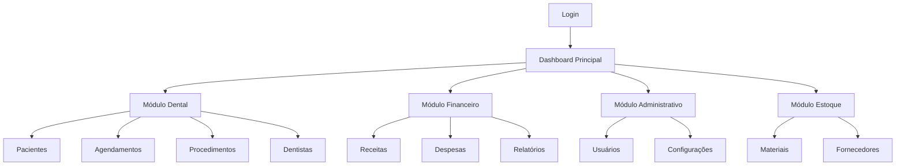

# Sistema de Gestão de Clínicas Odontológicas

## 1. Visão Geral do Produto

Uma plataforma SaaS modular e robusta para gestão completa de clínicas odontológicas, construída com arquitetura moderna em Go e DynamoDB. O sistema oferece módulos especializados para operações dentárias, gestão financeira, administrativa e de estoque, permitindo escalabilidade e manutenção eficiente.

O produto resolve os principais desafios de gestão clínica: agendamento de consultas, controle de pacientes, gestão financeira e administrativa, proporcionando uma solução integrada e moderna para profissionais da odontologia.

## 2. Funcionalidades Principais

### 2.1 Perfis de Usuário

| Perfil | Método de Registro | Permissões Principais |
|--------|-------------------|----------------------|
| Dentista | Registro com CRO | Acesso completo ao módulo dental, visualização financeira |
| Administrador | Convite do proprietário | Acesso total a todos os módulos |
| Recepcionista | Criação pelo administrador | Agendamentos, cadastro de pacientes, consultas básicas |
| Proprietário | Registro inicial da clínica | Acesso completo a todos os módulos e configurações |

### 2.2 Módulos Funcionais

O sistema de gestão de clínicas odontológicas é composto pelos seguintes módulos principais:

1. **Módulo Dental**: gestão de dentistas, pacientes, procedimentos e agendamentos
2. **Módulo Financeiro**: controle de receitas, despesas, faturamento e relatórios
3. **Módulo Administrativo**: gestão de usuários, configurações e permissões
4. **Módulo de Estoque**: controle de materiais, equipamentos e fornecedores
5. **Dashboard Principal**: visão geral e métricas da clínica

### 2.3 Detalhes das Páginas

| Nome da Página | Nome do Módulo | Descrição da Funcionalidade |
|----------------|----------------|----------------------------|
| Dashboard Principal | Visão Geral | Exibir métricas principais, agendamentos do dia, receitas, alertas de estoque |
| Gestão de Pacientes | Cadastro de Pacientes | Criar, editar, visualizar e excluir pacientes. Histórico médico, documentos |
| Agendamentos | Sistema de Agenda | Criar, editar, cancelar consultas. Visualização por calendário, conflitos |
| Procedimentos | Catálogo Dental | Gerenciar tipos de procedimentos, preços, duração, materiais necessários |
| Dentistas | Gestão de Profissionais | Cadastrar dentistas, especialidades, horários, comissões |
| Financeiro | Controle Financeiro | Receitas, despesas, relatórios, gráficos, fluxo de caixa |
| Estoque | Controle de Materiais | Materiais, fornecedores, pedidos, alertas de estoque baixo |
| Configurações | Administração | Usuários, permissões, configurações da clínica, backup |

## 3. Processo Principal

**Fluxo do Proprietário/Administrador:**
O proprietário acessa o dashboard principal, visualiza métricas e pode navegar para qualquer módulo. Gerencia configurações, usuários e tem acesso completo a relatórios financeiros e operacionais.

**Fluxo do Dentista:**
O dentista acessa sua agenda, visualiza pacientes do dia, registra procedimentos realizados, atualiza históricos médicos e consulta informações financeiras básicas.

**Fluxo da Recepcionista:**
A recepcionista gerencia agendamentos, cadastra novos pacientes, confirma consultas, processa pagamentos básicos e mantém a agenda atualizada.

## 4. Design da Interface do Usuário

### 4.1 Estilo de Design

- **Cores Primárias**: Azul médico (#2563EB), Verde saúde (#059669)
- **Cores Secundárias**: Cinza neutro (#6B7280), Branco (#FFFFFF)
- **Estilo de Botões**: Arredondados com sombra sutil, estados hover e active
- **Tipografia**: Inter ou Roboto, tamanhos 14px (corpo), 16px (títulos), 24px (cabeçalhos)
- **Layout**: Design baseado em cards, navegação lateral fixa, breadcrumbs
- **Ícones**: Heroicons ou Feather Icons para consistência médica

### 4.2 Visão Geral do Design das Páginas

| Nome da Página | Nome do Módulo | Elementos da UI |
|----------------|----------------|-----------------|
| Dashboard Principal | Visão Geral | Cards de métricas, gráficos de linha/barra, lista de agendamentos, alertas coloridos |
| Gestão de Pacientes | Cadastro | Tabela responsiva, filtros avançados, modal de edição, upload de documentos |
| Agendamentos | Agenda | Calendário interativo, timeline diária, drag-and-drop, códigos de cores por status |
| Financeiro | Relatórios | Gráficos interativos, filtros de data, exportação PDF/Excel, cards de resumo |
| Estoque | Materiais | Lista com alertas visuais, códigos de cores por nível, modal de pedidos |

### 4.3 Responsividade

O sistema é desktop-first com adaptação completa para tablets e smartphones. Inclui navegação mobile otimizada, gestos touch para agendamentos e interface simplificada para telas menores, mantendo todas as funcionalidades essenciais acessíveis.